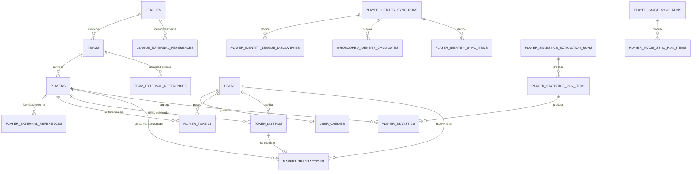
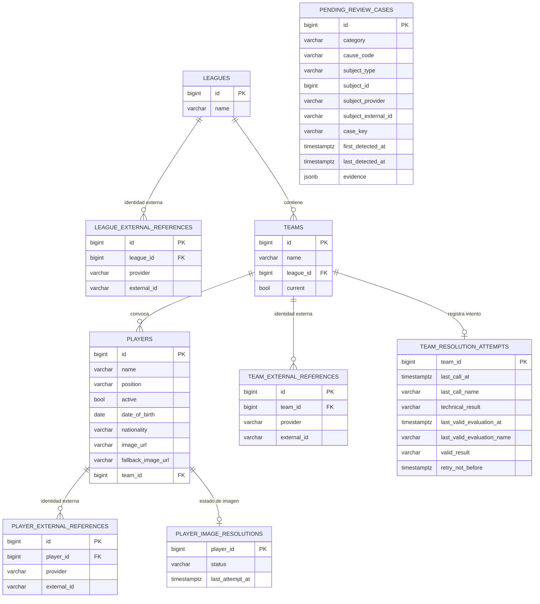
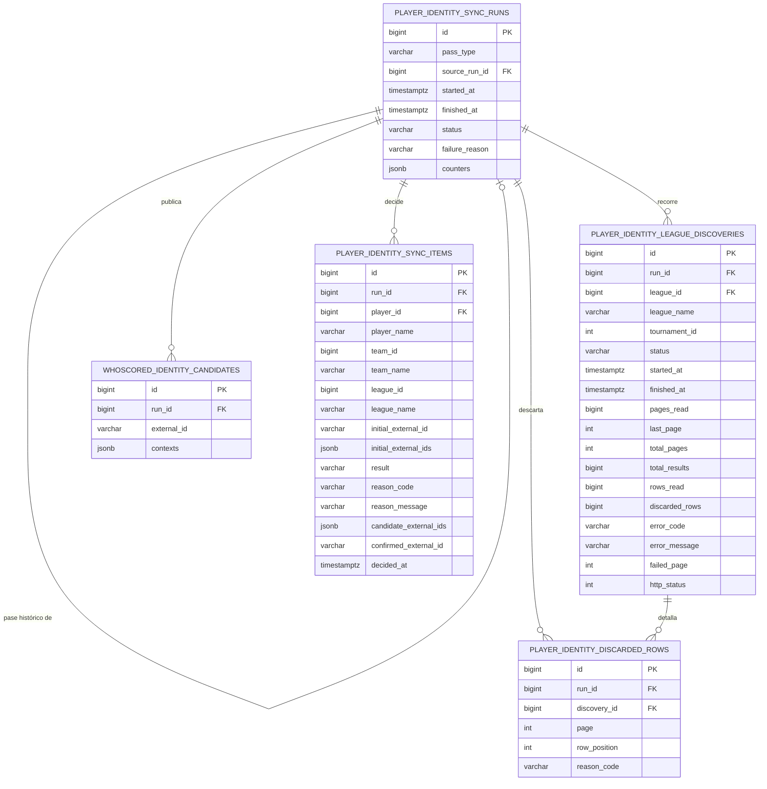
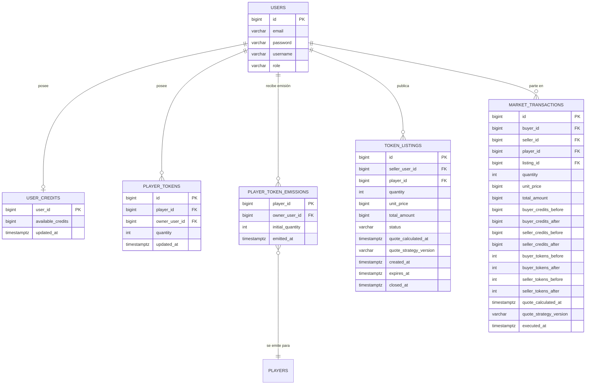
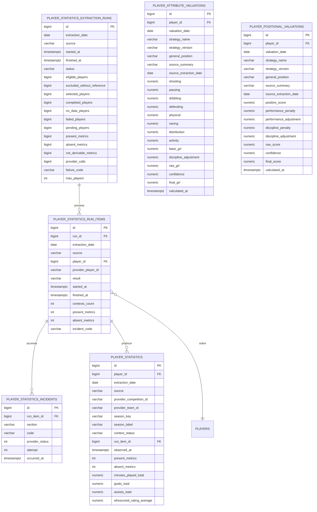
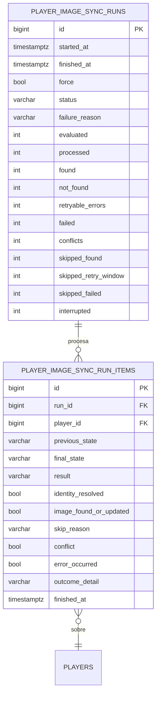

# Modelo de datos del backend

## Guía de lectura

Consultar este documento cuando la tarea afecte la persistencia: Model, Repository, migraciones,
validación del esquema o consultas que dependan de la forma de las tablas. La **fuente de verdad
del esquema** son las migraciones de `backend/src/main/resources/db/migration/`; este documento
describe la estructura efectiva de la base y su propósito, no el comportamiento funcional, que está
regido por los contratos de `specs/*/contracts/`. Para el modelo en memoria y las invariantes del
dominio, consultar [arquitectura del backend](architecture.md) §1.5; para el flujo
`DTO → Mapper → Model → Service`, consultar §1.

## 1. Origen del esquema

| Aspecto | Valor |
| --- | --- |
| Motor | PostgreSQL |
| Migraciones | `backend/src/main/resources/db/migration/` (15 archivos, Flyway) |
| Validación de arranque | `spring.jpa.hibernate.ddl-auto: validate` |
| Base de desarrollo | `football_market_dev` |

El esquema no se crea por mapeo de entidades: `validate` solo comprueba que el modelo JPA coincida
con lo migrado. Toda diferencia entre este documento y las migraciones es un defecto de este
documento.

## 2. Panorama general

El modelo se organiza en cinco dominios. Las tablas de un mismo dominio se validan juntas y
conservan su propia trazabilidad; los dominios se conectan por claves foráneas explícitas, nunca
por convención de nombres.

## 3. Dominio de catálogo

Catálogo propio del proyecto: ligas, equipos y jugadores, con su identidad desacoplada de
cualquier proveedor. Es la única fuente de verdad de "qué jugadores existen"; los identificadores
externos cuelgan de referencias, no del jugador.

| Tabla | Qué representa | Notas |
| --- | --- | --- |
| `leagues` | Las cinco ligas del mercado. | Raíz del catálogo. |
| `teams` | Equipos, con su liga y la marca `current` (equipo vigente en su liga). | Un jugador pertenece a un equipo, y transitivamente a una liga. |
| `players` | Jugadores del catálogo: nombre, posición, visibilidad (`active`), ficha e imagen. | `team_id` obligatorio: un jugador sin equipo resoluble no entra. |
| `league_external_references` | Identidad de una liga en un proveedor (`FOOTBALL_DATA`). | Único por `(league_id, provider)` y por `(provider, external_id)`. |
| `team_external_references` | Identidad de un equipo en un proveedor. | Misma unicidad que las ligas. |
| `player_external_references` | Identidad de un jugador en un proveedor. | Único por `(provider, external_id)`. Un jugador puede tener varias referencias de proveedores distintos: es el punto de unión con WhoScored. |
| `team_resolution_attempts` | Última llamada de resolución de un equipo y su resultado técnico. | Una fila por equipo; `retry_not_before` gobierna el reintento. |
| `player_image_resolutions` | Estado de resolución de imagen por jugador (`PENDING`, …). | Una fila por jugador; `last_attempt_at` permite reanudar. |
| `pending_review_cases` | Casos que requieren revisión manual, con su evidencia. | `subject_type` + `subject_id` la hacen polimórfica: el asunto puede ser un jugador o un equipo. `case_key` es única y evita duplicar el mismo caso. |

## 4. Dominio de identidad (WhoScored)

Traza completa de una sincronización de identidades: la ejecución, el recorrido por liga, los
candidatos observados en el proveedor, la decisión por jugador y las filas descartadas. Es un
dominio de auditoría: su escritura no modifica el catálogo, solo lo referencia.

| Tabla | Qué representa | Notas |
| --- | --- | --- |
| `player_identity_sync_runs` | Una ejecución de sincronización, con su pase (`CURRENT`/`HISTORICAL`), estado y contadores agregados. | `source_run_id` apunta al run `CURRENT` que origina un pase histórico. `counters` es un `jsonb` con el agregado de la ejecución. |
| `player_identity_league_discoveries` | El recorrido del proveedor para **una** liga dentro de una ejecución: páginas leídas, filas y error. | Único por `(run_id, league_id)`. Es el nivel en el que se aísla un fallo de proveedor: una liga bloqueada no impide recorrer las demás. |
| `whoscored_identity_candidates` | Candidatos observados en WhoScored, con todos sus contextos (nombre, equipo, liga, temporada). | Único por `(run_id, external_id)`. `contexts` es una lista porque un mismo `external_id` puede aparecer en varias ambigüedades. |
| `player_identity_sync_items` | La decisión tomada para **cada** jugador del catálogo: resultado, motivo y candidato confirmado. | Único por `(run_id, player_id)`. Es la traza auditable del matching. |
| `player_identity_discarded_rows` | Filas del proveedor que se descartaron por datos inválidos, con su página y posición. | Único por run y descubrimiento; conserva el motivo (`reason_code`). |

## 5. Dominio de mercado

Usuarios, créditos, tenencias de tokens, publicaciones y transacciones. Es el único dominio con
efecto económico: las publicaciones **reservan** tokens sin transferirlos, y la transacción mueve
tokens y créditos de forma atómica.

| Tabla | Qué representa | Notas |
| --- | --- | --- |
| `users` | Identidad de acceso: correo, usuario, contraseña y rol (`USER`/`SUPERUSER`). | Existe como máximo un `SUPERUSER` (índice único parcial). `password` es un hash. |
| `user_credits` | Saldo de créditos disponibles del usuario. | Una fila por usuario. El saldo se mueve solo por `market_transactions`. |
| `player_tokens` | Tenencia de tokens de un jugador por parte de un usuario. | Único por `(player_id, owner_user_id)`. Es el saldo que consume una publicación. |
| `player_token_emissions` | Emisión inicial de tokens: quién los recibió y con qué cantidad. | Una fila por jugador. Es la traza de la Emission y la base del costo y del resultado realizado de SPEC-015. |
| `token_listings` | Publicación de venta: precio congelado, cantidad, vigencia y estado. | `status` es materializado (`ACTIVE`/`SOLD`/`CANCELLED`); el estado **efectivo** se deriva de `status` y `expires_at`. `total_amount = quantity * unit_price`. |
| `market_transactions` | Compra confirmada, con las fotos de saldo antes y después. | `listing_id` es nulo en una compra directa al superusuario. La simetría de saldos permite reconstruir la operación sin depender del log. |

## 6. Dominio de estadísticas y valoraciones

Extracción de estadísticas desde WhoScored y su valoracion posterior. Es un dominio derivado: todas
sus filas son reproducibles a partir de la fuente y del estado del catálogo.

| Tabla | Qué representa | Notas |
| --- | --- | --- |
| `player_statistics_extraction_runs` | Una ejecución de extracción de estadísticas, con su alcance y sus contadores. | Único por `(id, extraction_date, source)`. `eligible_players` y `excluded_without_reference` explican por qué se eligió un subconjunto del catálogo. |
| `player_statistics_run_items` | El tratamiento de un jugador dentro de una ejecución. | Único por `(run_id, player_id)`. `provider_player_id` es el identificador en el proveedor, no el interno. |
| `player_statistics_incidents` | Incidencias técnicas del proveedor (bloqueo, límite de peticiones, error de transporte). | Una fila por intento fallido, con su sección y su código. |
| `player_statistics` | Métricas de un jugador para una fecha de extracción y una fuente. | Único por `(extraction_date, source, player_id)`. El catálogo cerrado de métricas está en `MetricCatalog`; la tabla materializa sus valores. |
| `player_attribute_valuations` | Valoración por atributos (GRL) de un jugador. | Único por `(player_id, valuation_date, strategy_name, strategy_version)`. `imputed_metrics` enumera las métricas sustituidas. |
| `player_positional_valuations` | Valoración posicional de un jugador. | Misma unicidad que la valoración por atributos. Ambas filas se publican o retiran juntas. |

## 7. Dominio de imágenes

Sincronización de imágenes de jugadores. Es independiente del resto: comparte el catálogo, pero no
participa en el mercado ni en las valoraciones.

| Tabla | Qué representa | Notas |
| --- | --- | --- |
| `player_image_sync_runs` | Una ejecución de sincronización de imágenes, con `force` y sus contadores. | Los contadores separan `skipped_found`, `skipped_retry_window` y `skipped_failed`: el motivo del salto importa. |
| `player_image_sync_run_items` | El resultado por jugador dentro de una ejecución. | Único por `(run_id, player_id)`. `identity_resolved` distingue "no se pudo identificar" de "no se encontró imagen". |

## 8. Tablas de soporte

| Tabla | Qué representa | Notas |
| --- | --- | --- |
| `flyway_schema_history` | Historial de migraciones aplicadas. | Gestionada por Flyway. No es parte del modelo del dominio. |

## 9. Reglas transversales del modelo

- **Identidad externa desacoplada.** Ninguna entidad de catálogo almacena el identificador de un
  proveedor en su propia fila: vive en una tabla `*_external_references` con la unicidad
  `(provider, external_id)`. Una entidad admite varias referencias de proveedores distintos.
- **Identificadores internos separados del proveedor.** Toda tabla que referencia a un proveedor
  distingue el id interno (`player_id`) del externo (`provider_player_id`, `external_id`).
- **Derivación en la lectura, no en la escritura.** `token_listings.status` es materializado, pero
  el estado efectivo se deriva de `status` y `expires_at`; `market_transactions` conserva las fotos
  de saldo en lugar de recomputarlas.
- **Auditoría antes que estado mutable.** Los dominios de sincronización (identidad, estadísticas,
  imágenes) son append-only por ejecución: cada run guarda su propio resultado y no modifica el
  anterior.
- **Borrado en cascada solo donde no hay historia.** Las referencias externas y las imágenes se
  borran en cascada con su entidad; las trazas de auditoría y las transacciones no.
