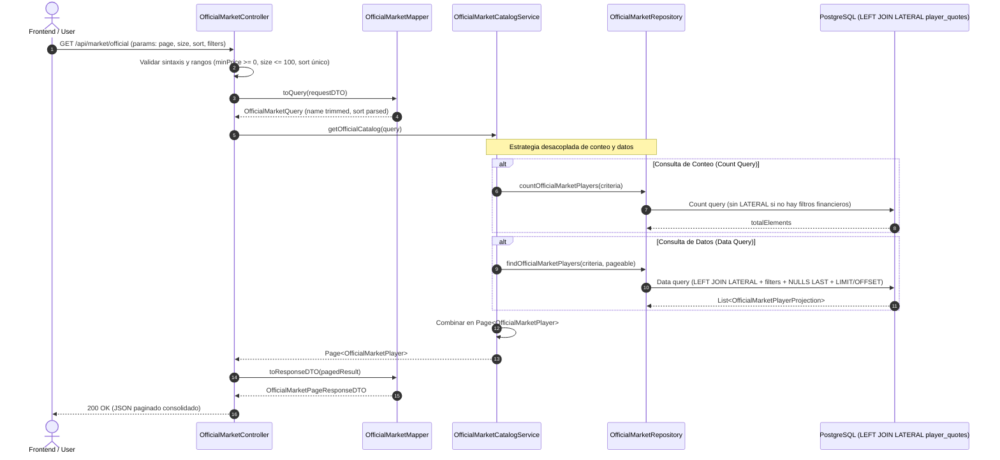

# Implementation Plan: Mercado Oficial — Compra de tokens y catálogo con cotizaciones integradas (SPEC-010)

**Branch**: `feat/010-buy-tokens` | **Date**: 2026-11-12 | **Spec**: [spec.md](spec.md)

**Input**: Feature specification from `/specs/010-buy-tokens/spec.md` (US1: Compra transaccional de tokens y US2: Catálogo con cotizaciones integradas, [Issue #90](https://github.com/YoelSLA/football-market/issues/90)).

---

## Summary

La feature `market` evoluciona para soportar de forma integral el Mercado Oficial primario:
1. **Transacción de compra (`POST /api/orders/buy`)**: Preservada íntegramente. Un usuario compra tokens contra el inventario del superusuario a precio vigente, con transferencias atómicas de créditos/tokens y asiento financiero inmutable (`BuyOrderService`).
2. **Catálogo consolidado (`GET /api/market/official`)**: Expone la lista paginada de jugadores elegibles con su cotización vigente consolidada en una única respuesta. Resuelve los filtros deportivos y financieros globales (`minPrice`, `maxPrice`, `hasQuote`), ordenamiento con `NULLS LAST` y paginación determinista directamente en PostgreSQL mediante una consulta con `LEFT JOIN LATERAL` encapsulada en `OfficialMarketRepository`, sin requerir migraciones de base de datos ni vistas permanentes, eliminando el patrón N+1 y protegiendo el sigilo de inventario del superusuario.

---

## Technical Context

**Language/Version**: Java 21, Spring Boot 4.1.1 (backend).

**Primary Dependencies**: Spring Web MVC, Spring Data JPA, Spring Security OAuth2 Resource Server, JJWT, Flyway, PostgreSQL, Jakarta Validation, Lombok.

**Storage**: PostgreSQL.
- Tablas existentes: `players`, `teams`, `leagues`, `player_quotes`, `user_credits`, `player_token_holdings`, `player_token_emissions`, `market_transactions`.
- **Esquema de base de datos**: No requiere nuevas tablas, vistas DDL permanentes ni migraciones Flyway adicionales (cero cambios DDL).

**Testing**: JUnit 5, Mockito, AssertJ, MockMvc, Testcontainers con PostgreSQL real. Ejecución a cargo de la persona usuaria conforme a la Constitución §6.
- Se contempla una suite de **pruebas de equivalencia canónica** (`OfficialMarketQuoteEquivalenceTest`) para contrastar el resultado de la consulta lateral contra `PlayerQuoteRepository.findLatestByPlayerId`.
- Se contempla la verificación del plan de ejecución (`EXPLAIN`) en entorno de prueba.

**Target Platform**: Linux server, JDK 21, PostgreSQL.

**Project Type**: Backend REST API (Spring Boot).

**Performance Goals**:
- `GET /api/market/official`: Respuesta paginada consolidada sin patrón N+1 en la JVM.
- Filtrado y ordenamiento sobre el conjunto total resueltos en el motor de base de datos antes de paginar.
- Plan de ejecución verificado mediante logging de sentencias e inspección de ejecución.

**Constraints**:
- **Sin dependencias Service → Service** (`docs/backend/architecture.md` §1.3): `OfficialMarketCatalogServiceImpl` depende exclusivamente de `OfficialMarketRepository` y del modelo de proyección; no invoca servicios de `catalog` ni de `quote`.
- **Sigilo de inventario**: Ninguna consulta del catálogo lee `player_token_holdings`, `player_token_emissions` ni balances de usuarios.
- **Inmutabilidad de compra**: `POST /api/orders/buy` no modifica su ruta, contrato, persistencia ni validaciones.
- **Normalización**: Reutilización de la función de base de datos `catalog_normalize_name` para búsqueda insensible a mayúsculas y acentos.

---

## Constitution Check

*GATE: Must pass before Phase 0 research. Re-check after Phase 1 design.*

| Principio | Resultado | Fundamento |
|---|---|---|
| **§1 Arquitectura del backend** | **PASS** | `OfficialMarketCatalogService` cumple estrictamente §1.3: depende solo de `Repository` y `Model`. Sin dependencias entre Services ni intermediarios innecesarios. |
| **§2 Calidad y alcance** | **PASS** | Resuelve el patrón N+1 mediante `LEFT JOIN LATERAL` encapsulado en la feature `market`. Sin migraciones DDL ni abstracciones innecesarias. |
| **§2.2 Proporcionalidad** | **PASS** | Cubre los 13 criterios de aceptación de forma testeable y directa. Respeta el sigilo de negocio. |
| **§2.1 Datos de desarrollo** | **PASS** | Cero impacto en el esquema Flyway existente; no altera datos ni tablas maestras. |
| **§3 Seguridad** | **PASS** | Autenticación JWT obligatoria en `GET /api/market/official` (401 sin sesión). La respuesta no filtra saldo ni existencias del superusuario. |
| **§4 Contratos** | **PASS** | Contratos sincronizados: `contracts/buy-tokens.md` y `contracts/official-catalog.md`. Códigos de error unificados. |
| **§5 Idioma** | **PASS** | Código, nombres de variables y símbolos en inglés; documentación y contratos en español. |
| **§6 Verificación** | **PASS** | El agente diseña los tests unitarios, de integración y de equivalencia canónica; la ejecución corre por cuenta del usuario. |
| **§8/§9 Gobernanza** | **PASS** | Mantiene la tríada permanente `spec.md`, `plan.md`, `tasks.md`. Trazabilidad unificada en `feat/010-buy-tokens` para Issue #90. |

---

## Project Structure

### Documentation (this feature)

```text
specs/010-buy-tokens/
├── spec.md              # Requisitos funcionales y casos de aceptación (US1 y US2)
├── plan.md              # Este plan de implementación arquitectónica
├── research.md          # Decisiones técnicas R-01 a R-20 (incluye equivalencia y LATERAL)
├── data-model.md        # Definición de tablas existentes, subconsulta LATERAL y proyecciones
├── quickstart.md        # Guía de verificación para la persona usuaria
├── contracts/
│   ├── buy-tokens.md    # Contrato HTTP POST /api/orders/buy
│   └── official-catalog.md # Contrato HTTP GET /api/market/official
└── checklists/
    └── requirements.md  # Checklist de calidad de requisitos
```

### Source Code Layout

```text
backend/
└── src/main/java/footballmarket/features/market/
    ├── presentation/
    │   ├── OfficialMarketController.java               # GET /api/market/official
    │   ├── OfficialMarketMapper.java                   # Mapeo DTO <-> Domain
    │   └── dtos/
    │       ├── request/
    │       │   └── OfficialMarketQueryRequestDTO.java  # Parámetros de consulta y validaciones Jakarta
    │       └── response/
    │           ├── OfficialMarketPageResponseDTO.java  # Contenedor paginado con metadatos
    │           ├── OfficialMarketPlayerResponseDTO.java# Datos del jugador en el mercado
    │           └── OfficialMarketQuoteResponseDTO.java # Datos de la cotización consolidada
    ├── application/
    │   ├── OfficialMarketCatalogService.java           # Interfaz de servicio
    │   ├── OfficialMarketQuery.java                    # Value object con criterios normalizados
    │   └── impl/
    │       └── OfficialMarketCatalogServiceImpl.java   # Orquestación de lectura y consulta al repositorio
    ├── domain/
    │   └── records/
    │       ├── OfficialMarketPlayer.java               # Modelo inmutable de jugador de mercado
    │       └── OfficialMarketQuote.java                # Modelo inmutable de cotización de mercado
    └── infraestructure/
        ├── OfficialMarketRepository.java               # Spring Data JPA con query nativa paginada y LEFT JOIN LATERAL
        └── projections/
            └── OfficialMarketPlayerProjection.java     # Interfaz de proyección de resultados SQL
```

---

## Detailed Design & Data Flow



### 1. Capa de Presentación
- **`OfficialMarketController`**:
  - `@RestController @RequestMapping("/api/market/official")`
  - Validaciones Jakarta y control de errores:
    - `minPrice < 0`, `maxPrice < 0` o `minPrice > maxPrice`: `400 Bad Request` (`INVALID_PRICE_RANGE`).
    - `page < 0`: `400 Bad Request` (`INVALID_PAGINATION`).
    - `size < 1` o `size > 100`: `400 Bad Request` (`INVALID_PAGE_SIZE`).
    - Múltiples parámetros `sort` o formato no permitido: `400 Bad Request` (`INVALID_SORT_PARAMETER`).
- **`OfficialMarketMapper`**:
  - Aplica `trim()` a `name`; si queda vacío, se omite.
  - Setea `quote = null` si el jugador no registra cotización (`quoteId == null`).
  - Setea `variationPercentage = null` si `previousPrice` es nulo o `<= 0`.
  - Mapea explícitamente los atributos de la proyección SQL al dominio y DTO: `score` -> `performanceScore` y `origin` -> `calculationOrigin`.

### 2. Capa de Aplicación
- **`OfficialMarketCatalogService`**:
  - Interfaz: `Page<OfficialMarketPlayer> getOfficialCatalog(OfficialMarketQuery query);`
  - Implementación desacopla la obtención del conteo total (`countQuery`) y la página de datos (`dataQuery`).
  - Si no existen filtros financieros, optimiza la consulta de conteo evitando unir con `player_quotes`.

### 3. Capa de Infraestructura y Acceso a Datos
- **`OfficialMarketRepository`**:
  - Define la consulta nativa en PostgreSQL utilizando `LEFT JOIN LATERAL`:
    ```sql
    SELECT
        p.id AS id,
        p.name AS name,
        p.position AS position,
        p.nationality AS nationality,
        t.id AS teamId,
        t.name AS teamName,
        l.id AS leagueId,
        l.name AS leagueName,
        p.image_url AS imageUrl,
        q.quote_id AS quoteId,
        q.price AS price,
        q.previous_price AS previousPrice,
        q.variation_percentage AS variationPercentage,
        q.score AS score,
        q.multiplier AS multiplier,
        q.origin AS origin,
        q.effective_date AS effectiveDate,
        q.calculated_at AS calculatedAt
    FROM players p
    JOIN teams t ON t.id = p.team_id
    JOIN leagues l ON l.id = t.league_id
    LEFT JOIN LATERAL (
        SELECT
            pq.id AS quote_id,
            pq.price,
            pq.previous_price,
            CASE
                WHEN pq.previous_price IS NOT NULL AND pq.previous_price > 0
                THEN ROUND(((pq.price - pq.previous_price)::numeric / pq.previous_price::numeric) * 100, 2)
                ELSE NULL
            END AS variation_percentage,
            pq.score,
            pq.multiplier,
            pq.origin,
            pq.effective_date,
            pq.calculated_at
        FROM player_quotes pq
        WHERE pq.player_id = p.id
        ORDER BY
            pq.effective_date DESC,
            (CASE WHEN pq.origin = 'RECOMPUTED' THEN 0 ELSE 1 END),
            pq.calculated_at DESC,
            pq.id DESC
        LIMIT 1
    ) q ON true
    WHERE p.active = true AND t.current = true
      AND (:leagueId IS NULL OR l.id = :leagueId)
      AND (:teamId IS NULL OR t.id = :teamId)
      AND (:position IS NULL OR p.position = :position)
      AND (:nationality IS NULL OR p.nationality = :nationality)
      AND (:name IS NULL OR catalog_normalize_name(p.name) LIKE concat('%', :name, '%'))
      AND (:hasQuote IS NULL OR (:hasQuote = true AND q.quote_id IS NOT NULL) OR (:hasQuote = false AND q.quote_id IS NULL))
      AND (:minPrice IS NULL OR q.price >= :minPrice)
      AND (:maxPrice IS NULL OR q.price <= :maxPrice)
    ORDER BY /* dinámico con NULLS LAST */ , p.id ASC
    LIMIT :size OFFSET :offset
    ```

---

## Plan de Verificación de Riesgos

1. **Riesgo de Duplicación de Reglas de Cotización**:
   - *Mitigación*: Se implementa la suite de pruebas `OfficialMarketQuoteEquivalenceTest`. Se verifica que ante múltiples filas de cotizaciones (iniciales, arrastradas y recalculadas), la cotización devuelta por `OfficialMarketRepository` sea exactamente idéntica a la resuelta por `PlayerQuoteRepository.findLatestByPlayerId`.
2. **Riesgo de Regresión en Compra Transaccional**:
   - *Mitigación*: `BuyOrderService` y `OrderController` permanecen 100% aislados e inalterados.
3. **Riesgo de Fuga de Inventario del Superusuario**:
   - *Mitigación*: La consulta excluye `player_token_holdings`. Pruebas de contrato validan la ausencia estricta de campos de stock en la respuesta JSON.
4. **Verificación de Rendimiento y Plan de Ejecución (Diagnóstico)**:
   - *Mitigación*: Se inspeccionará de forma diagnóstica el plan de ejecución (`EXPLAIN`) durante las pruebas para comprobar la estructura de la consulta y el aprovechamiento del índice `ix_player_quotes_player_date`, evitando aserciones rígidas de texto sobre `Index Scan` que dependan de la baja cardinalidad en bases de datos de prueba efímeras.
