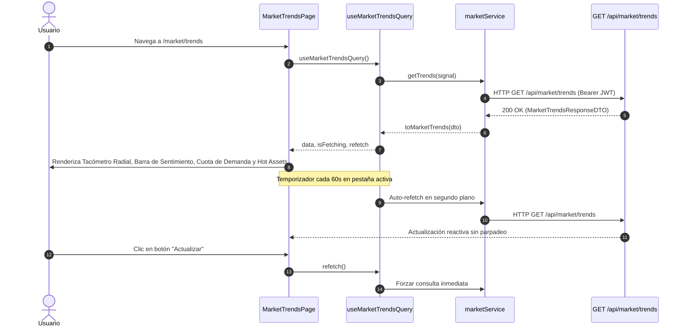
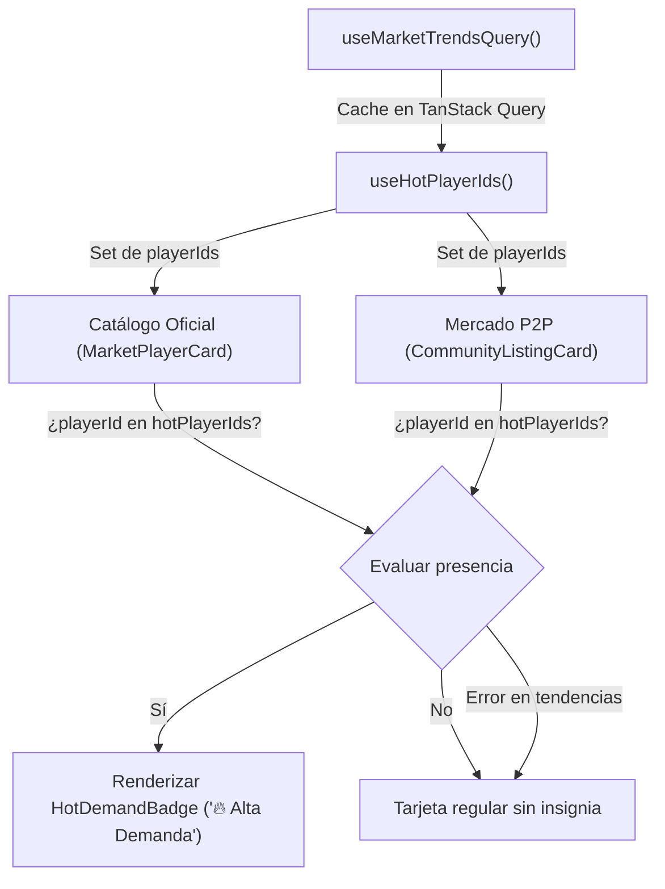

# Implementation Plan: Tablero de tendencias de mercado y visualización de demanda comunitaria (SPEC-029)

**Branch**: `feat/029-frontend-market-trends-and-sentiment` | **Date**: 2026-11-24 | **Spec**: [`spec.md`](spec.md)  
**Estado**: Plan de implementación técnico completado.  
**Referencias normativas**:
- [`spec.md`](spec.md) (Especificación viva clarificada)
- [`research.md`](research.md) (Decisiones de arquitectura técnica y hooks)
- [`data-model.md`](data-model.md) (Modelos, DTOs y mappers de dominio)
- [`contracts/market-trends-api.md`](contracts/market-trends-api.md) (Contrato `GET /api/market/trends`)
- [`contracts/quote-breakdown-api.md`](contracts/quote-breakdown-api.md) (Contrato de desglose de cotización)
- [`quickstart.md`](quickstart.md) (Guía de validación y escenarios interactivos)

---

## 1. Summary

Implementación en el frontend (`frontend/src/features/market/` y `frontend/src/features/players/`) de la experiencia completa de visualización analítica de mercado y demanda comunitaria:
1. **Tablero de Tendencias de Mercado (`/market/trends`)**:
   - Pestaña `"Tendencias"` en la barra de navegación del Mercado (`frontend/src/app/navigation/sections.ts`) y ruta en `AppRouter.tsx`.
   - Hook reactivo `useMarketTrendsQuery` con política combinada: auto-refresco en segundo plano cada 60s (pausado en pestañas inactivas) y botón de refresco manual para forzar la actualización inmediata.
   - **Tacómetro Radial de Sentimiento (`MarketSentimentGauge`)**: medidor semicircular SVG interactivo con gradiente cromático (rojo $\rightarrow$ amarillo $\rightarrow$ verde), aguja indicadora orientada dinámicamente y lectura digital de presión compradora neta.
   - **Barra de Sentimiento Segmentada (`MarketSentimentBar`)**: visualización proporcional de compras (verde esmeralda) vs. ventas (rojo rubí), con chip de sesgo (`Alcista`, `Bajista`, `Neutral`) y soporte para empty state de mercado en calma.
   - **Gráfico de Distribución de Cuota de Demanda (`MarketDemandShareChart`)**: barras horizontales proporcionales que exhiben la cuota relativa (%) de cada activo del Top 5 sobre el volumen total del grupo.
   - Tarjetas de métricas cuantitativas `MarketMacroMetrics`: volumen total operado en créditos y cantidad total de transacciones completadas.
   - Ranking de activos destacados `MarketHotAssets`: grilla responsiva de tarjetas con los 5 futbolistas más demandados de la comunidad (*Hot Assets*), exhibiendo nombre, club, tokens comprados y volumen en créditos, con enlace directo al perfil individual.
2. **Insignias de Alta Demanda en Catálogos**:
   - Hook selector `useHotPlayerIds` que expone el conjunto de futbolistas en tendencia desde la caché de TanStack Query sin peticiones adicionales.
   - Componente `HotDemandBadge` (*"🔥 Alta Demanda"*) inyectado en las tarjetas del Catálogo Oficial (`MarketPlayerCard`) y del Mercado P2P (`CommunityListingCard`), con tooltip explicativo accesible.
3. **Desglose de Cotización en Detalle del Jugador (`PlayerDetailPage`)**:
   - Enriquecimiento del modelo de dominio `PlayerQuote` con los factores de auditoría provistos por el backend de `SPEC-028`: `sportMultiplier`, `marketDemandFactor` y `origin`.
   - Componente interactivo `PlayerQuoteBreakdownPopover` en `PlayerOverviewQuote.tsx` que desglosa pedagógicamente el Aporte Deportivo (+X.XX%) y la Presión de Mercado (+Y.YY%), explicando de forma transparente la fórmula de cotización.

---

## 2. Technical Context

- **Frontend Stack**: React 19.3.0 + TypeScript 7.0.2, TanStack Query v5, SCSS Modules con tokens centralizados `@/styles/abstracts`.
- **Backend Dependencies**: Endpoints de `SPEC-028` (`GET /api/market/trends` y cotizaciones de `QuoteResponseDTO`).
- **Almacenamiento y Estado**: TanStack Query cache (`marketQueryKeys.trends()`, `playersQueryKeys.detail()`), cliente `http` con token JWT activo.
- **Target Platform & Viewport**: Aplicación web desktop adaptativa ($\ge 1024$ px) con cobertura responsiva fluida, conforme a Constitución §Viewport.
- **Testing y Verificación**: Escenarios de validación en `quickstart.md`; verificación estática y compilación de frontend (`npm run build`) conforme a la Constitución y AGENTS del área.

---

## 3. Constitution Check

*GATE: Evaluación frente a los principios fundamentales de la Constitución.*

| Principio | Evaluación de Cumplimiento |
| :--- | :--- |
| **I. Simplicidad y calidad** | **PASA.** Cero dependencias externas adicionales. El tacómetro radial, la barra de sentimiento y el gráfico de barras se resuelven con SVG nativo y CSS Modules. Reutilización de componentes y estilos del design system (`@/styles/abstracts`). |
| **II. Proporcionalidad del alcance** | **PASA.** Se ciñe estrictamente a las 4 User Stories del issue #97 (tablero `/market/trends`, componentes gráficos de sentimiento y cuota, ranking Hot Assets, badges en catálogos y popover de desglose en detalle). Se excluyen gráficos candlestick y modificaciones en backend. |
| **III. Seguridad e integridad** | **PASA.** Toda petición utiliza cliente `http` con `authenticated: true` (Bearer JWT). Manejo de errores que no expone datos sensibles ni trazas internas. |
| **IV. Coherencia de contratos** | **PASA.** Contratos documentados en `contracts/market-trends-api.md` y `contracts/quote-breakdown-api.md`. Manejo exacto en centésimas en la API y normalización a créditos en los mappers de frontend. |
| **V. Trazabilidad y fuente de verdad** | **PASA.** Asignación registrada en `specs/assignments.md`. Tríada permanente obligatoria preservada (`spec.md`, `plan.md`, `tasks.md`). Pull Request #116 vinculado al issue #97. |
| **Viewport Desktop** | **PASA.** Soporte prioritario para resolución Desktop ($\ge 1024$ px) y adaptación responsiva sin scroll horizontal. |
| **Verificación y testing** | **PASA.** El agente no ejecuta tests de aplicación. Control permitido: `npm run build` en `frontend/`. |

---

## 4. Arquitectura de Componentes del Frontend

### 4.1. Estructura de Archivos a Crear / Modificar

```text
frontend/src/
├── app/
│   ├── navigation/
│   │   └── sections.ts                                           # Agregar pestaña 'Tendencias' en market
│   └── router/AppRouter/
│       └── AppRouter.tsx                                         # Agregar ruta /market/trends
├── features/
│   ├── market/
│   │   ├── constants/
│   │   │   └── marketQueryKeys.ts                                # trends: () => ["market", "trends"]
│   │   ├── hooks/
│   │   │   └── queries/
│   │   │       ├── useMarketTrendsQuery.ts                       # Hook TanStack Query (refetchInterval: 60s)
│   │   │       ├── useHotPlayerIds.ts                            # Hook selector para IDs en tendencia
│   │   │       └── index.ts                                      # Exportación pública
│   │   ├── market.service.ts                                     # Método getTrends
│   │   ├── market.mapper.ts                                      # Mapper toMarketTrends
│   │   ├── types/
│   │   │   ├── dtos.ts                                           # MarketTrendsResponseDTO, TopHotPlayerDTO
│   │   │   └── models.ts                                         # MarketTrends, TopHotPlayer, MarketBias
│   │   ├── components/
│   │   │   ├── HotDemandBadge/                                   # Badge '🔥 Alta Demanda' con tooltip
│   │   │   │   ├── HotDemandBadge.tsx
│   │   │   │   ├── HotDemandBadge.module.scss
│   │   │   │   └── index.ts
│   │   │   ├── MarketPlayerCard/MarketPlayerCard.tsx             # Integración de HotDemandBadge en oficial
│   │   │   └── CommunityListingCard/CommunityListingCard.tsx     # Integración de HotDemandBadge en P2P
│   │   └── pages/
│   │       └── MarketTrendsPage/                                 # Pantalla principal del Tablero
│   │           ├── MarketTrendsPage.tsx
│   │           ├── MarketTrendsPage.module.scss
│   │           ├── components/
│   │           │   ├── MarketTrendsHeader/                       # Título, ventana y botón refrescar
│   │           │   ├── MarketSentimentGauge/                     # Tacómetro radial semicircular SVG
│   │           │   ├── MarketSentimentBar/                       # Barra gráfica de sentimiento y sesgo
│   │           │   ├── MarketDemandShareChart/                   # Gráfico de barras horizontales de cuota Top 5
│   │           │   ├── MarketMacroMetrics/                       # Tarjetas de volumen y transacciones
│   │           │   ├── MarketHotAssets/                          # Grilla ranking de jugadores más demandados
│   │           │   ├── MarketTrendsSkeleton/                     # Esqueletos de carga
│   │           │   └── MarketTrendsEmptyState/                   # Estado de mercado en calma
│   │           └── index.ts
│   └── players/
│       ├── types/
│       │   ├── dtos.ts                                           # sportMultiplier, marketDemandFactor
│       │   └── models.ts                                         # QuoteBreakdownFactors, PlayerQuote
│       ├── utils/
│       │   └── playerQuotes.ts                                   # deriveQuoteBreakdown y mapeo enriquecido
│       └── pages/
│           └── PlayerDetailPage/components/PlayerOverview/components/
│               ├── PlayerOverviewQuote/
│               │   ├── PlayerOverviewQuote.tsx                   # Inyección del botón de desglose
│               │   └── PlayerOverviewQuote.module.scss
│               └── PlayerQuoteBreakdownPopover/                  # Popover con desglose deportivo vs demanda
│                   ├── PlayerQuoteBreakdownPopover.tsx
│                   ├── PlayerQuoteBreakdownPopover.module.scss
│                   └── index.ts
```

---

## 5. Diseño Detallado de Flujos e Integraciones

### 5.1. Consulta Reactiva y Sincronización en Tendencias


### 5.2. Inyección de Badges de Demanda en Catálogos


---

## 6. Verificación y Plan de Entrega

1. **Compilación estática:**
   ```bash
   cd frontend && npm run build
   ```
2. **Higiene de código y formato:**
   ```bash
   cd frontend && npm run check
   ```
3. **Verificación interactiva:** Ejecutar los 4 escenarios de validación detallados en [`quickstart.md`](quickstart.md).
