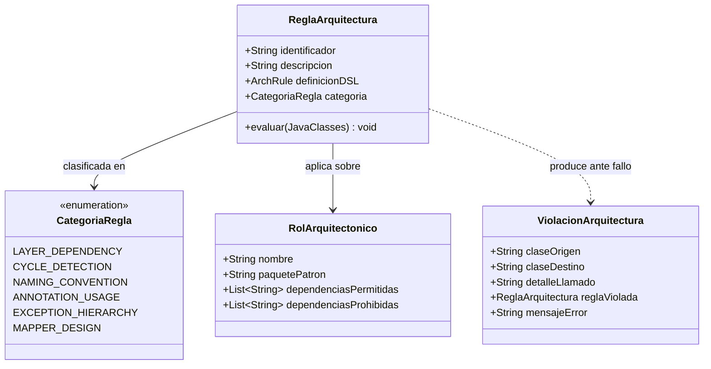

# Modelo de Conceptos y Abstracciones Arquitectónicas

**Feature**: `SPEC-037 | Tests de arquitectura en el backend`
**Fecha**: 2026-11-27
**Rama**: `feat/037-arch-tests`

La suite de pruebas de arquitectura no define tablas relacionales ni modelos persistidos en PostgreSQL. Este documento describe las abstracciones y conceptos evaluados sobre la topología del código fuente compilado.

---

## 1. Entidades Conceptuales de Arquitectura

---

## 2. Definición de Roles del Backend

Conforme a [`docs/backend/architecture.md`](file:///home/yoelsla/Escritorio/football-market/docs/backend/architecture.md) §1.1–§1.3:

| Rol | Paquetes / Patrón | Responsabilidad | Dependencias Permitidas | Dependencias Prohibidas |
| --- | --- | --- | --- | --- |
| **Presentation (Controller)** | `..presentation..` | Exposición de endpoints HTTP REST | DTO, Mapper, Service, Orchestrator | Repository, Infrastructure, Persistence, Model directo |
| **DTO** | `..presentation.dtos..`, `..dtos..` | Contratos de Request/Response HTTP | Tipos básicos Java, validaciones Jakarta | Service, Model, Repository |
| **Mapper** | `..presentation.mappers..`, `..mappers..` | Transformación DTO ↔ Model (estática) | DTO, Model | Service, Repository, beans Spring |
| **Application (Service)** | `..application..` | Orquestación de casos de uso y lógica de aplicación | Model, Repository, Integration | Controller, Presentation |
| **Domain (Model)** | `..domain..` | Lógica, estado e invariantes del dominio | Tipos básicos, anotaciones JPA estándar | Presentation, Spring Web, Integration, Service |
| **Persistence / Infrastructure** | `..infra*structure..`, `..persistence..` | Adaptadores, repositorios Spring Data | Model | Presentation, Service (como consumidor) |
| **Orchestrator** | `footballmarket.orchestrators..` | Coordinación entre Services | Service, Model (transporte opaco) | Repository, Integration, otros Orchestrators |

---

## 3. Estados del Proceso de Validación

* **Evaluación Satisfactoria (PASS):** El grafo de llamadas y dependencias de las clases analizadas respeta todas las restricciones declaradas.
* **Violación Detectada (FAIL):** Existe al menos una referencia de tipo, llamada a método, instanciación o importación que contraviene la regla. La prueba aborta con `AssertionError`, listando:
  * Clase y método de origen con número de línea.
  * Clase y miembro de destino referenciado.
  * Texto explicativo de la regla violada.
